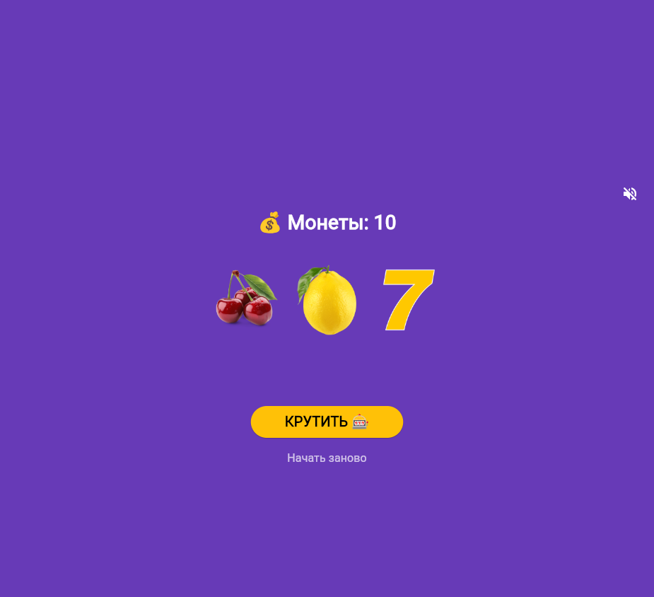

# Лабораторная работа №10. Слот-машина
Автор: Куриев Артур. Группа: ИСП-241. Дата: 09.11.2026г.
| Главный экран | Результат | Монеты закончились |
| --- | --- | --- |
|  |  |  |
- Запуск: `flutter pub get`, затем `flutter run -d chrome` или `flutter run -d ID_устройства`.
- Звук включается отдельной кнопкой; до её нажатия приложение молчит.
- Сборка Android: `flutter build apk --release`.
- Готовый файл: `build/app/outputs/flutter-apk/app-release.apk`.
- APK: [APK Файл](https://github.com/APTYPMORGAN/Flutter_Lab10/releases/download/v1.0.0/app-release.apk)
- Проверенные Flutter/Dart:
• Flutter 3.47.9
• Dart 3.13.7
• DevTools 2.60.0
- Изучено: состояние и анимация; локальные ресурсы; аудиофокус; жизненный цикл и освобождение плееров; иконки; Web и Android release-сборки.