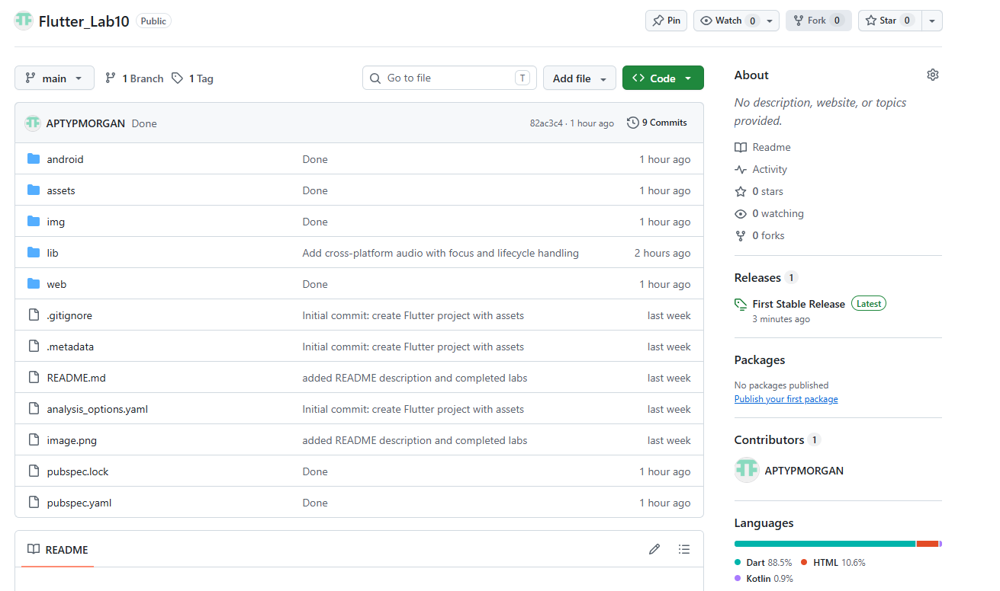

# Лабораторная работа №9. Flutter: StatefulWidget и управление состоянием

#### Автор:

- Куриев Артур
- ИСП-241
- Дата сдачи: 02.11.2026

### Что я изучил:

1. Изучил разницу между `StatelessWidget` и `StatefulWidget`
2. Научился менять состояние приложения с помощью `setState()`
3. Научился работать с картинками и кнопками во `Flutter`

### Финальный скриншот

### Инструкция по запуску:

1. `git clone https://github.com/APTYPMORGAN/Flutter_Lab9`
2. `cd Flutter_Lab9`
3. `flutter pub get`
4. `flutter run -d chrome`
